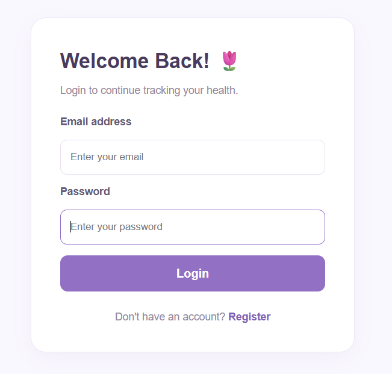
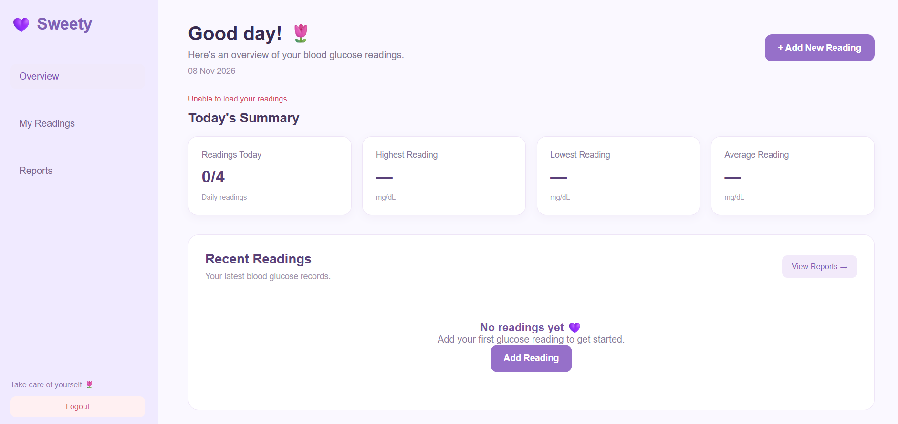
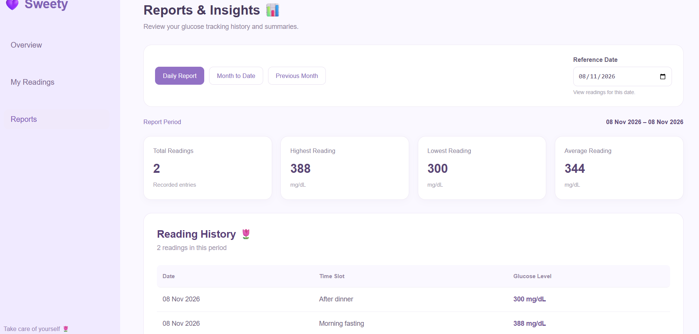

# Sweety – Blood Glucose Tracker

A full-stack web application that helps users record, manage, and monitor their daily blood glucose levels through daily and monthly reports.

## Features

### Authentication
- User registration and login
- Password hashing using bcrypt
- JWT-based authentication
- Protected routes and user-specific data access

### Blood Glucose Management
- Add, view, edit, and delete glucose readings
- Record readings across four daily time slots:
  - Morning fasting
  - After breakfast
  - After lunch
  - After dinner
- Glucose validation between 40 and 600 mg/dL
- Prevent duplicate readings for the same time slot and date
- Prevent future-dated readings
- Maximum of four readings per day

### Reports
- Daily glucose report
- Month-to-date report
- Previous-month report
- Highest, lowest, average glucose levels, and total reading count
- Handles dates with no recorded readings

## Technology Stack

| Layer | Technology |
|---|---|
| Frontend | React, Vite, CSS |
| Backend | Node.js, Express.js |
| Database | PostgreSQL |
| Authentication | JSON Web Tokens (JWT) |
| Password Security | bcryptjs |
| API Communication | Axios |

## Project Structure

```text
Sweety/
├── backend/
│   ├── src/
│   │   ├── config/
│   │   ├── controllers/
│   │   ├── middleware/
│   │   ├── routes/
│   │   └── server.js
│   ├── .env.example
│   └── package.json
│
├── frontend/
│   ├── src/
│   │   ├── components/
│   │   ├── context/
│   │   ├── pages/
│   │   ├── services/
│   │   ├── App.jsx
│   │   └── index.css
│   └── package.json
│
├── .gitignore
└── README.md
```

## Prerequisites

Install the following before running the application:

- Node.js and npm
- PostgreSQL
- Git

## Installation and Setup

### 1. Clone the repository

```bash
git clone <your-github-repository-url>
cd Sweety
```

### 2. Set up the PostgreSQL database

Create a database named:

```sql
CREATE DATABASE sweety_glucose;
```

Connect to the database and execute:

```sql
CREATE TABLE users (
    id SERIAL PRIMARY KEY,
    name VARCHAR(100) NOT NULL,
    email VARCHAR(150) UNIQUE NOT NULL,
    password VARCHAR(255) NOT NULL,
    created_at TIMESTAMP DEFAULT CURRENT_TIMESTAMP
);

CREATE TABLE readings (
    id SERIAL PRIMARY KEY,
    user_id INTEGER NOT NULL REFERENCES users(id) ON DELETE CASCADE,
    reading_date DATE NOT NULL,
    time_slot VARCHAR(30) NOT NULL,
    glucose_level INTEGER NOT NULL
        CHECK (glucose_level BETWEEN 40 AND 600),
    created_at TIMESTAMP DEFAULT CURRENT_TIMESTAMP,

    CONSTRAINT unique_user_reading_slot
        UNIQUE (user_id, reading_date, time_slot),

    CONSTRAINT valid_time_slot
        CHECK (
            time_slot IN (
                'Morning fasting',
                'After breakfast',
                'After lunch',
                'After dinner'
            )
        )
);
```

### 3. Configure the backend

Navigate to the backend directory:

```bash
cd backend
npm install
```

Create a `.env` file using `.env.example` as a template and configure your local PostgreSQL credentials and JWT secret.

### 4. Start the backend

```bash
npm run dev
```

The backend runs at:

```text
http://localhost:5000
```

### 5. Configure the frontend

Open another terminal:

```bash
cd frontend
npm install
```

### 6. Start the frontend

```bash
npm run dev
```

Open the local URL displayed by Vite in your browser.

## API Endpoints

### Authentication

| Method | Endpoint | Description |
|---|---|---|
| POST | `/api/auth/register` | Register a new user |
| POST | `/api/auth/login` | Log in |

### Glucose Readings

All reading endpoints require JWT authentication.

| Method | Endpoint | Description |
|---|---|---|
| GET | `/api/readings` | Get user readings |
| POST | `/api/readings` | Add a reading |
| PUT | `/api/readings/:id` | Update a reading |
| DELETE | `/api/readings/:id` | Delete a reading |

### Reports

All report endpoints require JWT authentication and a date query parameter in `YYYY-MM-DD` format.

| Method | Endpoint | Description |
|---|---|---|
| GET | `/api/reports/daily?date=YYYY-MM-DD` | Daily report |
| GET | `/api/reports/mtd?date=YYYY-MM-DD` | Month-to-date report |
| GET | `/api/reports/monthly?date=YYYY-MM-DD` | Previous-month report |

## Validation and Security

- Passwords are hashed before being stored.
- JWT authentication protects private API endpoints.
- Users can access only their own readings.
- Database constraints prevent duplicate time slots and invalid glucose values.
- Backend validation rejects invalid dates, future dates, and invalid readings.
- Database credentials and secrets are stored in environment variables.

## Assumptions

- Each user can record a maximum of four readings per day.
- Each of the four time slots can have only one reading per date.
- Glucose values are recorded in mg/dL.
- Reports use calendar-date ranges.
- Dates are handled using the Asia/Kolkata timezone for current-date validation.

## Future Improvements

- Glucose trend charts and visual analytics.
- Pagination for reading history.
- Export reports as PDF.
- Medication and meal tracking.
- Configurable glucose target ranges.

---

**Sweety – Blood Glucose Tracker**

Developed as part of the Kenpath Junior Full Stack Developer assessment.

## Demo Account

Use the following credentials to explore the application:

- **Email:** demo@sweety.com
- **Password:** SweetyDemo@123

The project includes sample glucose readings for demonstrating daily and monthly reports.

To recreate the demo data locally, run:

```bash
cd backend
npm run seed
```

Note: These are public assessment demo credentials, not production credentials.


## Application Screenshots

### Login


### Dashboard


### Add Reading


### Reading History


### Reports

